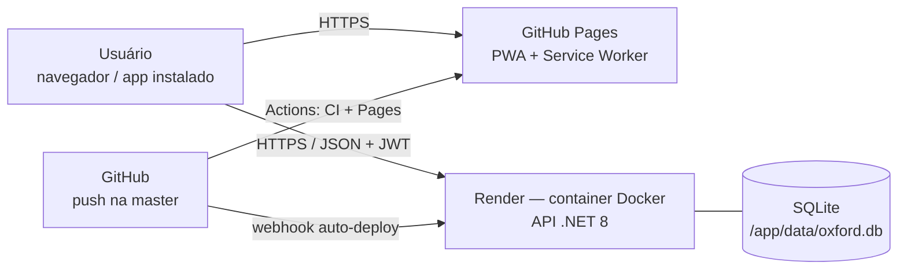

# Deploy na nuvem (gratuito) — Oxford English School

| Camada | Serviço (plano gratuito) | URL final |
|---|---|---|
| Back-end (API .NET 8) + banco **SQLite** | **Render** — Web Service Docker, plano *Free* | `https://oxford-api.onrender.com` |
| Front-end (PWA) | **GitHub Pages** | `https://maranijoao.github.io/Oxford-EnglishSchool/` |
| CI/CD | **GitHub Actions** + auto-deploy do Render | — |

## Como o banco SQLite funciona

- O banco é um arquivo (`oxford.db`) dentro do container da API. Não há servidor de banco nem conta extra.
- Ao iniciar, a API **cria as tabelas sozinha** (`EnsureCreated`), cria o **usuário administrador**
  a partir de `Admin__Email` / `Admin__Senha` e, se `Seed__DadosExemplo=true`, insere professores,
  alunos e aulas de exemplo. Tudo isso só acontece se o banco estiver vazio.
- O modelo físico está documentado em [`database/schema-sqlite.sql`](database/schema-sqlite.sql).

> ⚠️ **Limitação do plano gratuito (citar no PIM, Etapa 8):** o disco do Render *Free* é efêmero.
> O serviço hiberna após ~15 min sem acesso e, ao acordar (ou a cada novo deploy), o container começa
> com um disco limpo: **os dados cadastrados se perdem** e a API recria o banco com o admin e os dados de
> exemplo. Serve bem para demonstração/apresentação. Para manter os dados de verdade, basta montar um
> volume persistente em `/app/data` (ex.: *Persistent Disk* do Render, plano pago, ou `docker run -v`
> em qualquer VM) — nenhum código precisa mudar.

---

## 1. Back-end — Render (Docker, gratuito)

1. Faça push deste repositório para o GitHub (branch `master`).
2. Crie conta em <https://render.com> entrando com o GitHub.
3. **New → Blueprint**, escolha o repositório `Oxford-EnglishSchool`. O Render lê o `render.yaml`
   e cria o serviço `oxford-api` (Docker, plano free, health check em `/health`).
4. Preencha as variáveis pedidas:
   - `Admin__Email` → e-mail de login do administrador
   - `Admin__Senha` → senha do administrador (fica só no Render, não no código)
   - `Cors__AllowedOrigins` → `https://maranijoao.github.io`
   - `Jwt__Key` é gerada automaticamente e `Seed__DadosExemplo` já vem `true`.
5. Aguarde o build. Teste:
   - `https://oxford-api.onrender.com/health` → `Healthy`
   - `https://oxford-api.onrender.com/api/Relatorios/dashboard` → contagens públicas
   - O Swagger (`/swagger`) só existe ao rodar a API em Development (local).
   - Todas as outras rotas exigem login (`Authorization: Bearer <token>`); sem token → 401.
6. Se o Render atribuir outra URL (nome já usado), atualize `API_URL_PRODUCAO` em
   `Front-End Oxford/js/config.js`.

A partir daqui, **todo push na `master` refaz o deploy da API** (CD).

## 2. Front-end PWA — GitHub Pages (gratuito)

1. No GitHub: **Settings → Pages → Build and deployment → Source: GitHub Actions**.
2. Faça push (ou rode manualmente **Actions → Deploy - Front-end → Run workflow**).
3. Acesse `https://maranijoao.github.io/Oxford-EnglishSchool/`.
4. Para instalar como app:
   - **Chrome/Edge (PC ou Android):** botão **Instalar app** no menu do site, ou ícone de instalação na barra de endereço.
   - **iPhone (Safari):** Compartilhar → **Adicionar à Tela de Início**.

> Dica para a apresentação: abra a URL da API (`/health`) ~1 minuto antes, para o serviço "acordar".

### O que o PWA faz

| Recurso | Arquivo |
|---|---|
| Manifesto (nome, cores, ícones, atalhos Dashboard/Administração) | `manifest.webmanifest` |
| Service worker: cache do app shell, consulta offline dos últimos dados da API (network‑first), escrita sempre online | `sw.js` |
| Registro do SW, botão "Instalar app", aviso de offline | `js/pwa.js` |
| URL da API local × produção | `js/config.js` |
| Página de fallback sem conexão | `offline.html` |
| Ícones (normal, *maskable*, Apple) | `icons/` |

Ao alterar arquivos do front, incremente `VERSION` em `sw.js` para os usuários receberem a nova versão.

## 3. Rodando localmente

- API: abrir a solution no Visual Studio e rodar o perfil **https**. O arquivo `oxford.db` é criado
  na pasta do projeto, com o login de desenvolvimento definido em `appsettings.Development.json`
  e dados de exemplo.
- Front: abrir `Front-End Oxford/index.html` com o Live Server (em `localhost`, o `config.js`
  aponta automaticamente para `https://localhost:7131`).
- Para zerar o banco local, apague `oxford.db` e rode a API de novo.

## 4. Pipeline CI/CD (GitHub Actions)

| Workflow | Quando roda | O que faz |
|---|---|---|
| `ci-api.yml` | push/PR que altera a API ou o Dockerfile | `dotnet restore` → `dotnet build` → `docker build` |
| `deploy-frontend.yml` | push que altera `Front-End Oxford/` | publica o PWA no GitHub Pages |
| Render auto-deploy | push na `master` | build da imagem Docker e troca do container |
